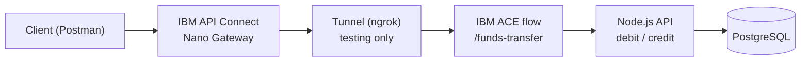
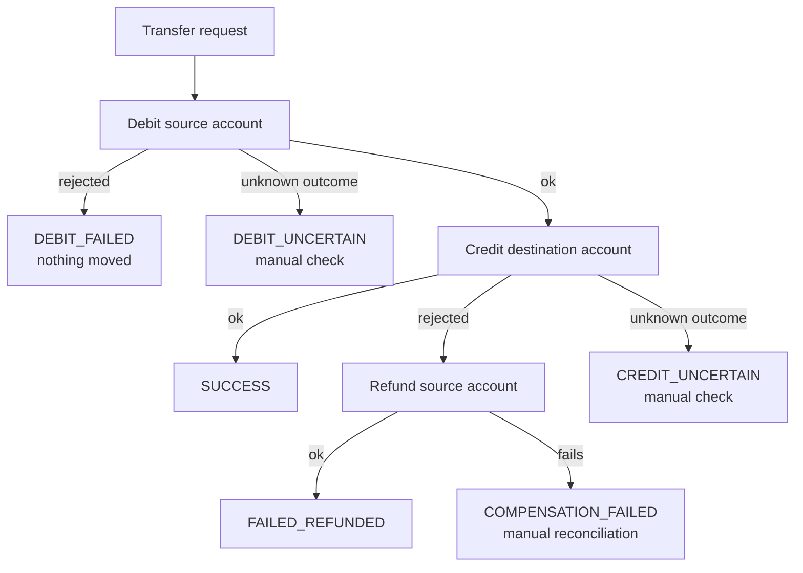
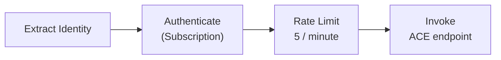
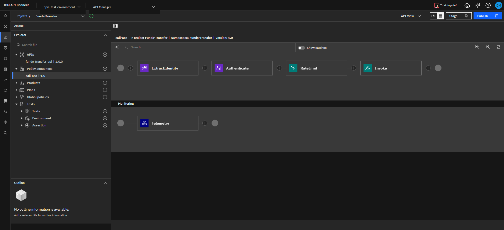
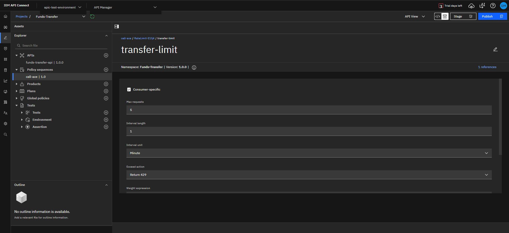
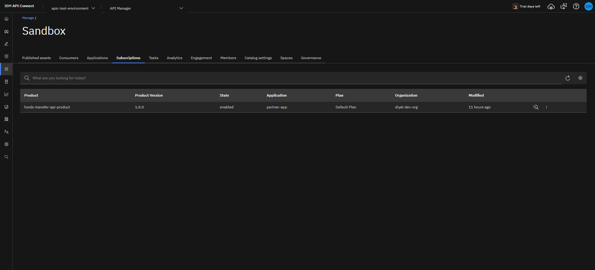

# IBM API Connect Funds Transfer API

> Personal learning project. Not affiliated with or endorsed by IBM.

A funds-transfer REST API published through **IBM API Connect** (v12, DataPower Nano Gateway).
An **IBM App Connect Enterprise (ACE 12)** flow orchestrates each transfer: it debits the source
account, credits the destination, and **automatically refunds the source if the credit fails**.

**Stack:** IBM API Connect · IBM ACE 12 (ESQL) · Node.js · Express · PostgreSQL · OpenAPI 3.0 · Postman · ngrok (testing only)

## Contents

1. [Architecture](#architecture)
2. [How a transfer works](#how-a-transfer-works)
3. [API Connect setup](#api-connect-setup)
4. [Screenshots](#screenshots)
5. [Tests performed](#tests-performed)
6. [Troubleshooting story](#troubleshooting-story)
7. [Known limitations](#known-limitations)
8. [Planned improvements](#planned-improvements)
9. [Repository layout](#repository-layout)

## Architecture



| Component | Role |
|---|---|
| **API Connect** | Publishes the API, checks credentials, applies the rate limit |
| **ngrok** | Lets the cloud trial gateway reach ACE on a laptop (testing only) |
| **ACE flow** | Orchestrates debit, credit and refund; writes trace logs |
| **Node.js API** | Debit and credit endpoints (a refund is a credit back to the source) |
| **PostgreSQL** | Account balances |

## How a transfer works



| `status` | Meaning |
|---|---|
| `SUCCESS` | Debit and credit both applied |
| `DEBIT_FAILED` | Debit rejected, nothing moved |
| `FAILED_REFUNDED` | Credit failed, source account refunded |
| `DEBIT_UNCERTAIN` / `CREDIT_UNCERTAIN` | Timeout or connection failure; outcome unknown |
| `COMPENSATION_FAILED` | Refund failed; manual reconciliation needed |

## API Connect setup

Policy sequence `call-ace`:



| Setting | Value |
|---|---|
| Gateway / catalog | DataPower Nano Gateway / Sandbox |
| Base path and operation | `/funds-transfer-api`, `POST /transfer` |
| Security | API key: `X-IBM-Client-Id` and `X-IBM-Client-Secret` headers |
| Rate limit | 5 requests per minute, over the limit returns 429 (shared across applications) |
| Invoke | Plain URL to the ACE endpoint, 60 s timeout |
| TLS client profile | `tls-client-profile-catalog-default:1.0.0` (required for any https target) |

The gateway files are in [`apic/`](apic). The Invoke URL there is a placeholder.

## Screenshots

### Published API


*The API in the Sandbox catalog with state `online-success`.*

### Policy sequence


*Extract Identity, Authenticate, Rate Limit and Invoke.*

### Rate limit definition


*5 requests per 1 minute; exceeding the limit returns 429.*

### Applications and subscriptions


*Applications subscribed to the Default Plan of the product.*

### Consumer Catalog


*The developer's view of the product.*

### Security tests (Postman)


*A wrong secret is rejected with 401.*


*Valid credentials reach ACE; an oversized amount returns `DEBIT_FAILED` and no money moves.*

### Transfer tests (Postman)


*A real transfer returns `SUCCESS`.*


*A transfer to an unknown account returns `FAILED_REFUNDED`; the source balance is unchanged.*

### Analytics


*Gateway events: 200, 401 and 429 responses.*


## Tests performed

| Case | Result |
|---|---|
| No credentials | 401 |
| Missing Client ID or missing secret | 401 |
| Wrong secret | 401 |
| Valid credentials, amount too large | `DEBIT_FAILED` |
| Valid credentials, transfer between two accounts | `SUCCESS`, balances changed |
| Valid credentials, unknown destination account | `FAILED_REFUNDED`, source balance unchanged |
| More than 5 calls in a minute | 429 |

## Troubleshooting story

The gateway returned `200` with an **empty body**. The ngrok inspector showed that ACE was replying
correctly, so the fault had to be inside the gateway. The Invoke policy had explicit `input` and
`output` message settings; removing them made the gateway return the backend's reply.
I found the fix by testing and have not confirmed the internal reason.

A second finding: the security scheme in the OpenAPI file did **not** enforce anything on the
Nano Gateway. Enforcement started only after I added Extract Identity and Authenticate policies
to the sequence.

## Known limitations

- The rate limit is **shared across applications**, even with consumer-specific ticked.
- Analytics shows App name as `n/a`, so calls from different applications cannot be told apart.
- A second application briefly returned a 500 that cleared without any change; the cause was not found.
- A rejected transfer came back as HTTP 200 through the gateway, so callers should read the `status` field.
- ngrok is a temporary public tunnel; ACE would need permanent hosting for real use.
- Trial gateway only: no OAuth, JWT, DataPower or full Developer Portal work.

See [`docs/findings.md`](docs/findings.md) for what was and was not confirmed.

## Planned improvements

Prepared in [`planned/`](planned) but **not yet applied or tested**:

- Idempotent transfers: a `transferId` and a `transfer_ledger` table so a retried request cannot move money twice.
- Postman collection for automated tests.
- Per-application rate limiting and gateway-level input validation.

## Repository layout

```
├── README.md
├── backend-node/   Node.js API (debit and credit endpoints)
├── ace/            IBM ACE project (message flow and ESQL)
├── apic/           IBM API Connect policy and API files
├── planned/        prepared, untested improvements
└── docs/           findings, notes and screenshots
```
